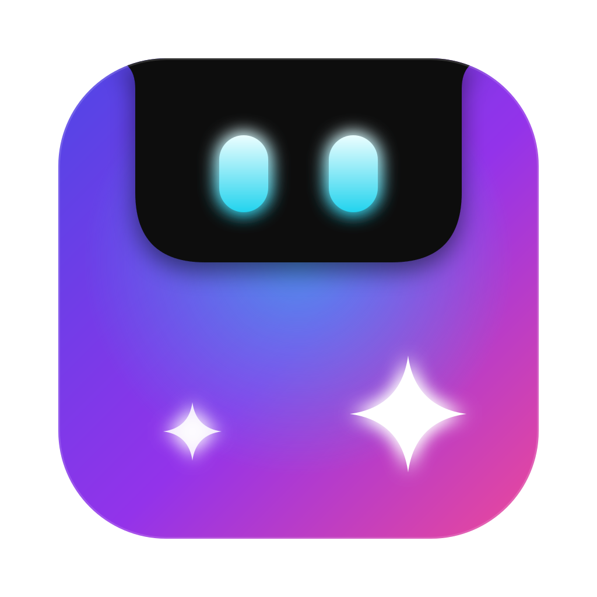

<h1 align="center">
  <br>
  
  <br>
  TwaNotch
  <br>
</h1>

<p align="center">A personal build of <a href="https://github.com/TheBoredTeam/boring.notch">boring.notch</a> that turns the MacBook notch, or the top of any display on a Mac without one, into a music, calendar, shelf and HUD hub.</p>

## What it does

- Now Playing live activity with controls and visualizer (Apple Music, Spotify, YouTube Music, any Now Playing source).
- Calendar and Reminders in the notch.
- Mirror (camera preview).
- Charging indicator and battery percentage.
- File shelf with AirDrop and quick share.
- System HUD replacement for volume, brightness and keyboard backlight.
- English and Vietnamese interface.

## How it differs from upstream

- Own bundle identifier (`com.twan.twanotch`), name and icon, so it installs side by side with Boring Notch and keeps separate settings and permissions.
- Sparkle auto-update is disabled; upstream releases can never replace this build. Update by rebuilding from source.
- Hardware-aware: features the Mac cannot drive (battery, display brightness on external monitors, keyboard backlight, mirror without a camera) are hidden, and their keys go back to macOS. On a Mac mini this hides most of them. Toggle it in Settings > General > Hardware.
- Settings redesigned in the style of macOS System Settings.
- Vietnamese translation, with a language picker in Settings > General > Language (System default, English, Tiếng Việt). Changing it restarts the app.

## Music sources

Choose the source in Settings > Media > Music Source.

- **Now Playing** (recommended) reads whatever macOS shows in Control Center, so it works with Chrome and Safari tabs, YouTube Music installed as a Chrome web app, Spotify and Apple Music.
- **YouTube Music** only works with the third-party desktop app [pear-desktop](https://github.com/pear-devs/pear-desktop) and its API server enabled. It does not detect YouTube Music in a browser or as a Chrome web app.
- **Apple Music** and **Spotify** talk to those apps directly through AppleScript.

## Building from source

Requirements: macOS 15.6 or later and Xcode 26 or later.

```bash
git clone https://github.com/twan-nguyen/twanotch.git
cd twanotch
open boringNotch.xcodeproj
```

Select the `boringNotch` scheme and press `Cmd + R`. To install, archive a Release build and copy `TwaNotch.app` into `/Applications`.

The project is signed ad hoc by default. Two consequences:

- macOS treats every ad-hoc rebuild as a new app, so Accessibility permission (needed for the HUD replacement) has to be granted again after each rebuild.
- The app links `MediaRemoteAdapter.framework`, which keeps its original signature. An ad-hoc app cannot load a framework from a different team, so `boringNotch.entitlements` includes `com.apple.security.cs.disable-library-validation`. Without it the app crashes at launch with "different Team IDs".

Selecting your own team under Signing & Capabilities fixes the first point and lets you drop that entitlement.

If macOS blocks the first launch of an unsigned build:

```bash
xattr -dr com.apple.quarantine /Applications/TwaNotch.app
```

## Upstream reference

This repository starts from a snapshot of boring.notch at commit `64b5459` and does not share its git history, so upstream changes are not merged automatically. To look at or port an upstream fix:

```bash
git remote add upstream https://github.com/TheBoredTeam/boring.notch.git
git remote set-url --push upstream no_push
git fetch upstream
git diff 64b5459 upstream/main -- boringNotch/managers/MusicManager.swift
```

The source folder and target names (`boringNotch`, `BoringNotchXPCHelper`) are kept unchanged so upstream files still line up path for path.

## Translations

UI strings live in `boringNotch/Localizable.xcstrings`. A command-line build does not add new strings to the catalog, so after adding UI text either build once in Xcode or run:

```bash
xcodebuild -exportLocalizations -project boringNotch.xcodeproj -localizationPath /tmp/twanotch-loc -exportLanguage vi
```

Then add the `vi` translation for the new keys in the catalog.

Some text is still English in Vietnamese mode: system permission prompts, onboarding step descriptions and the names of HUD styles and music sources.

## Icon

The app icon source is [Configuration/branding/twanotch-icon.svg](Configuration/branding/twanotch-icon.svg). After editing it, regenerate the PNGs in `boringNotch/Assets.xcassets/AppIcon.appiconset` (for example with `rsvg-convert`).

## Credits and license

TwaNotch is based on [boring.notch](https://github.com/TheBoredTeam/boring.notch) by TheBoredTeam and its contributors, and is distributed under the same [GPL-3.0 license](LICENSE). It also builds on [MediaRemoteAdapter](https://github.com/ungive/mediaremote-adapter) and [NotchDrop](https://github.com/Lakr233/NotchDrop); see [THIRD_PARTY_LICENSES](THIRD_PARTY_LICENSES) for all attributions.
